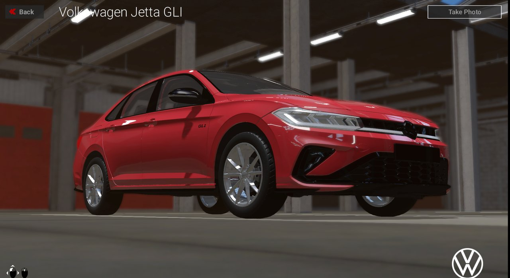
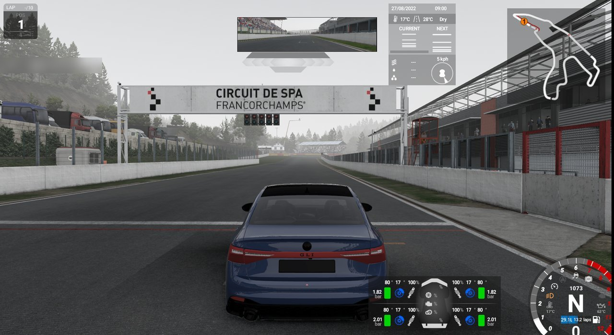
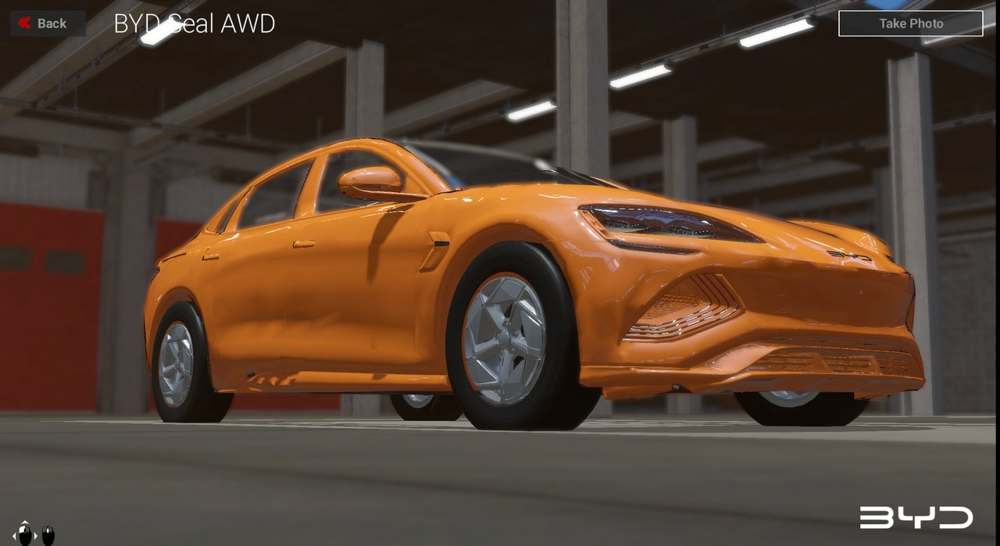
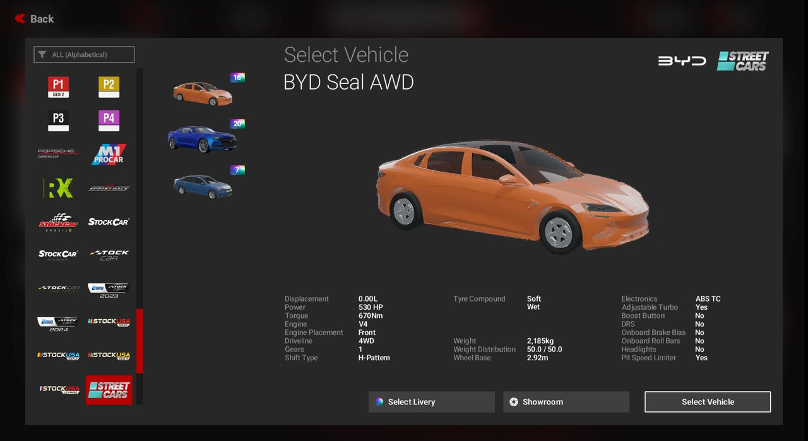
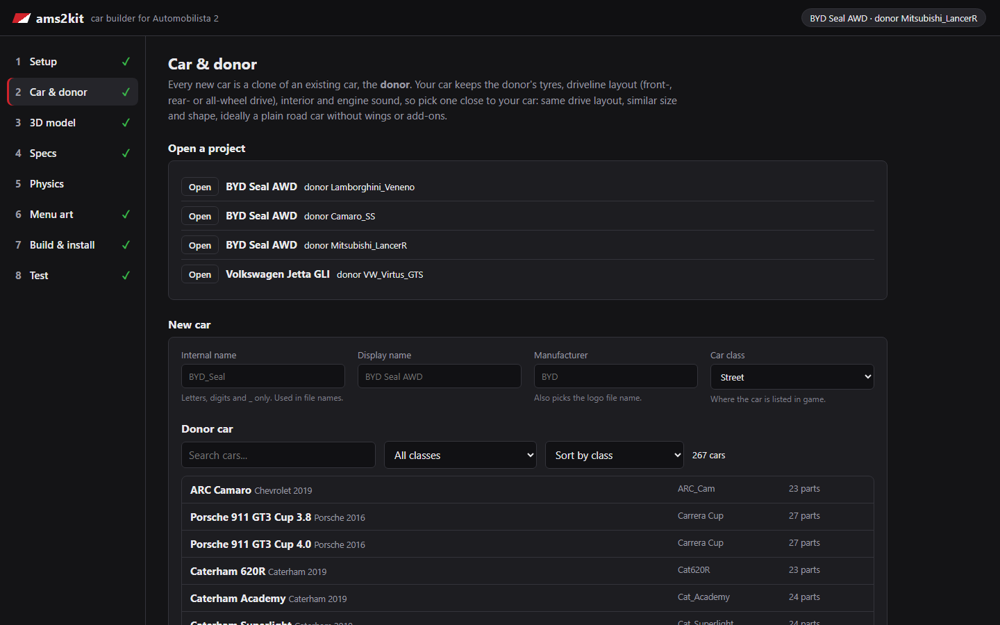
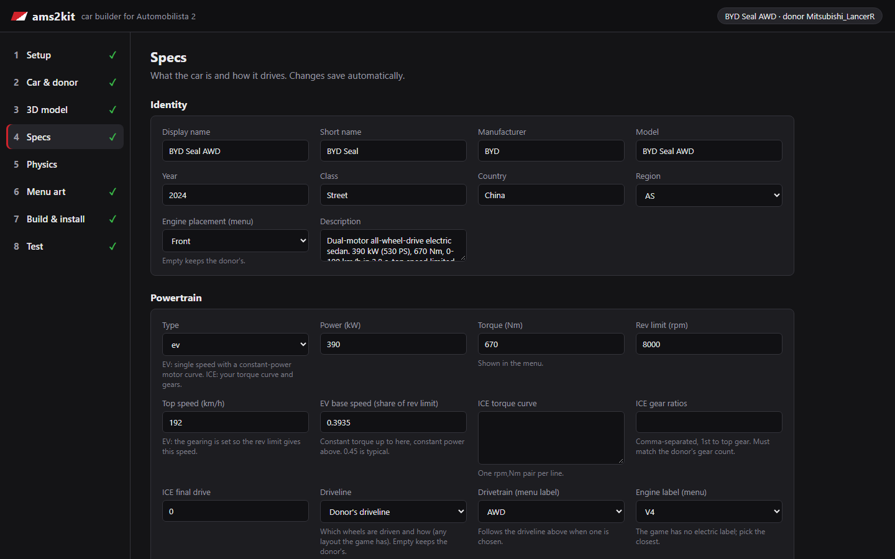
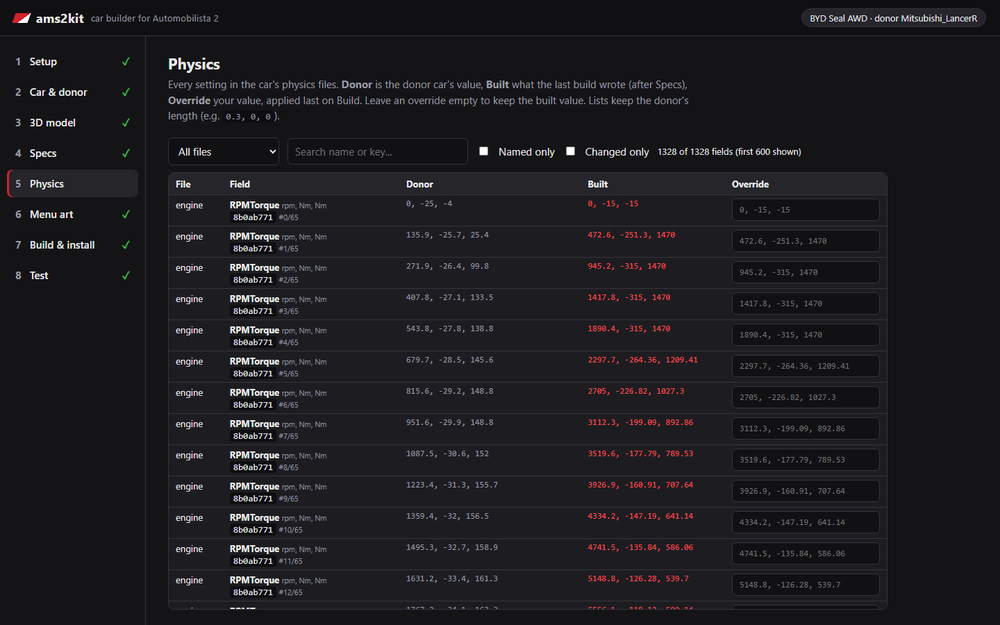
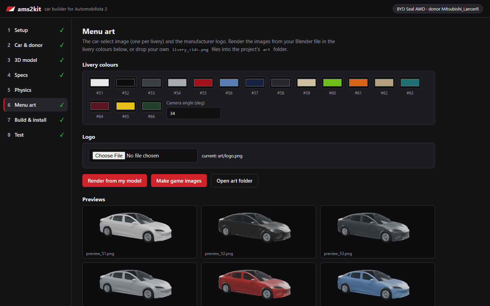

# ams2kit

**Add new cars to Automobilista 2 by cloning a car that is already in the game.**

Pick a base-game car as the **donor**, give your car a name and specs, put your own body on it in
Blender, and ams2kit builds the game files, installs them (reversibly) and can drive a test lap for you.
It has a local web UI and a command line.

> **Unofficial fan tool.** Not affiliated with or endorsed by Reiza Studios. You need your own copy of
> Automobilista 2 on Steam. This repository contains **no game assets**: donor files are read from your
> own installation at run time. See [Disclaimer](#disclaimer).

**What it does:** donor clone · your own meshes via a Blender `.blend` round trip · EV or ICE powertrain ·
mass, CG, wheelbase, tracks · tyre sizes · plain-paint liveries, logo and menu images · physics field
editor and overrides · engine sound from any car, with your own samples · build checks (Doctor) · install/uninstall with receipts · automated in-game test
with telemetry.

## Screenshots

Two cars built with ams2kit, running in the game:

> [!WARNING]
> These cars use downloaded 3D models that were only meant for testing the toolkit, imported as they
> are. Visible flaws such as dented panels are in those test models, not limits of the game or of ams2kit.
> A properly modelled and textured car will look much better.

| | |
|---|---|
|  |  |
| Volkswagen Jetta GLI: showroom | Volkswagen Jetta GLI: on the grid at Spa |
|  |  |
| BYD Seal AWD (electric, dual motor): showroom | BYD Seal AWD: vehicle select, with its own menu stats and logo |

### The toolkit

A local web UI walks you through each step, from picking the donor to installing and testing the car:

| | |
|---|---|
|  |  |
| **Car & donor:** start a project from any installed car | **Specs:** identity, powertrain (EV or ICE), chassis and tyres |
|  |  |
| **Physics:** every physics field, donor vs built value, with your overrides | **Menu art:** livery colours and car-select images rendered from your model |

## Requirements

- **Windows** 10/11, 64-bit
- **Automobilista 2** on **Steam**
- **Python 3.11+** with `pillow` and `numpy`
- **Blender 5.x** (for the `.blend` export/build and menu-image renders)

The UI and the build tools also start on macOS and Linux (game and Blender detection, project files),
but only Windows is tested. Running the game for the automated test and reading Oodle-compressed pak
entries need Windows.

## Install

```powershell
git clone <this repository> ams2kit
cd ams2kit
py -3 -m pip install --user -r requirements.txt
```

Nothing else to install: ams2kit runs from the folder.

## Quick start

1. Double-click `ams2kit.bat` (or run `python -m ams2kit`). The UI opens in your browser.
2. **Setup:** check the detected game and Blender folders.
3. **New car:** pick a donor, enter a name, manufacturer and class.
4. **Specs**, optionally **Model** (export the donor `.blend`, put your car in it, build meshes), **Art**.
5. **Build → Check → Install**, then start the game (or run **Test**) and find your car in its class.

Step-by-step guide and CLI equivalent: [docs/workflow.md](docs/workflow.md).

## Status

Work in progress (v0.1.0). It works end to end for the donors it was developed with. Main gaps:

- own textures work through clones of donor materials; livery designs are not supported (plain colours);
- interior and collision shape stay the donor's; engine sound can come from any car (samples
  replaceable);
- electric cars are emulated through the engine model;
- tested on a handful of donors only; game updates can break it.

Full list: [docs/known-limitations.md](docs/known-limitations.md). Changes: [CHANGELOG.md](CHANGELOG.md).

A separate launcher project (start the game straight onto the grid) exists outside this repository.

## Documentation

- [docs/workflow.md](docs/workflow.md): adding a car, step by step
- [docs/cli.md](docs/cli.md): command reference
- [docs/safety.md](docs/safety.md): what it changes in the game folder, backups, uninstalling
- [docs/known-limitations.md](docs/known-limitations.md)
- [docs/README.md](docs/README.md): research notes on the game's file formats
- [DESIGN.md](DESIGN.md), [CONTRIBUTING.md](CONTRIBUTING.md), [REVIEW.md](REVIEW.md)

## License

[MIT](LICENSE). The pak decryption and hashing code is derived from PCarsTools; see
[THIRD_PARTY_NOTICES.md](THIRD_PARTY_NOTICES.md).

## Disclaimer

ams2kit is an unofficial, non-commercial fan tool, not affiliated with, endorsed by or supported by Reiza
Studios, Valve/Steam, the Blender Foundation or any car manufacturer. Trademarks belong to their owners.
You need your own legitimately purchased copy of Automobilista 2. This repository contains no game files
or assets, and you must not add any. Cars you build contain data derived from your own installation:
share them only where the game's terms and the rights of model authors allow it. Use at your own risk and
keep backups.
